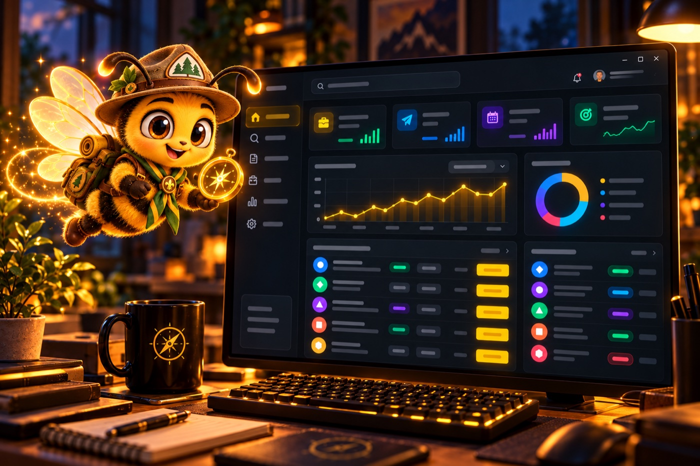
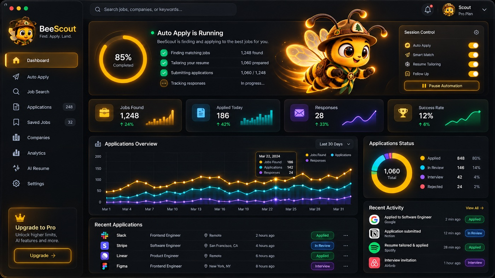
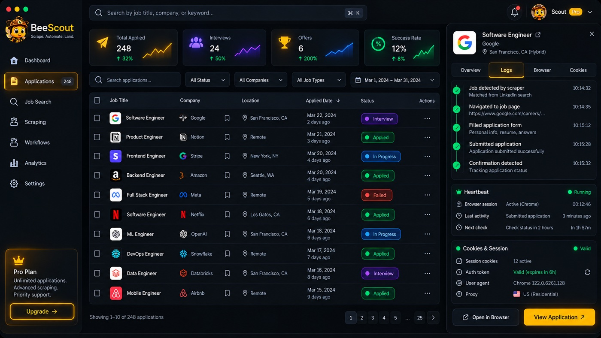
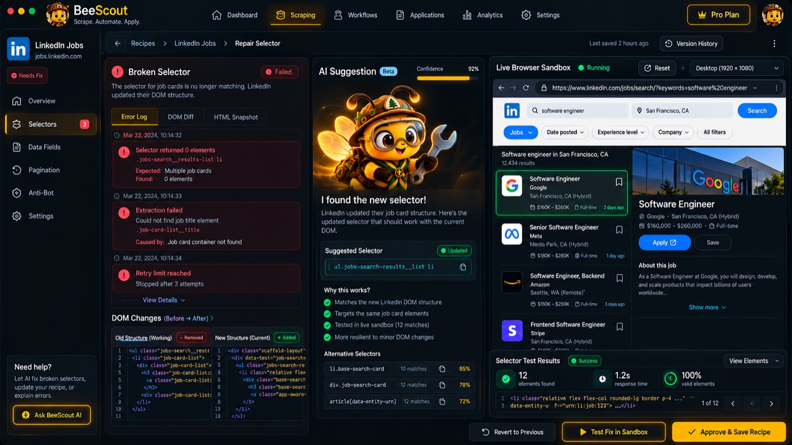
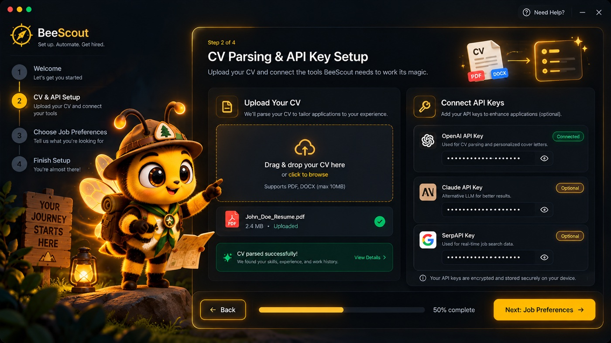
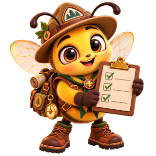

<div align="center">


# BeeScout

*Smart scouting, smooth applying.*

### Your AI-powered, autonomous job hunter

**Don't search, BeeScout.** Your personal AI agent scans job portals, prepares applications<br/>and fixes its own automation when websites change. You stay in control.

<sub>Local-first · Bring your own AI · You approve what gets sent</sub>


<a href="../../subscription"></a>

</div>

<p align="center"></p>

> [!NOTE]
> BeeScout is in **early development**. The screens below are design concepts. Watch or star this repository to follow the launch.

---

## 🐝 Why BeeScout?

Job hunting means the same search, filter and form-filling over and over, across many portals. BeeScout scouts for you:

<table>
<tr>
<td width="68%" valign="top">

- 🧭 **Finds:** searches the portals you choose, using your preferences
- 📝 **Prepares:** fills applications from a structured profile built from your CV
- ✅ **Asks first:** nothing is submitted without your approval
- 🔧 **Self-repairs:** when a website changes its layout, BeeScout proposes a fix, tests it and asks you to approve it
- 📊 **Tracks:** every job, application and step is logged in one place

</td>
<td width="32%" align="center"></td>
</tr>
</table>

## 🔒 Built on principles

| | |
|---|---|
| **Local-first** | Your CV, profile, history and keys stay on your device. No BeeScout account, no cloud, no telemetry. |
| **Bring your own key** | OpenAI, Anthropic Claude, DeepSeek, Google Gemini, Groq, OpenRouter, or a fully local model with Ollama. |
| **Human in the loop** | You review and approve applications and every automation change. |
| **Respectful by design** | Human pace, in your own browser, with hard daily limits. No CAPTCHA solving, no proxy rotation, no fake accounts. |

## ✨ What's inside

<table>
<tr>
<td width="50%" valign="top">

### 🧾 Recipes: readable automation
Each job portal is described by a **BeeScout Recipe** (`.bsr`), a small declarative YAML file anyone can read, review and share. Recipes cannot run arbitrary code and can only visit the domains they declare.

</td>
<td width="50%" valign="top">

```yaml
metadata:
  name: "Example Portal — Job Search"
  allowed_domains: ["jobs.example.com"]
workflow:
  - step: navigate
    url: "https://jobs.example.com/search?q={{role}}"
  - step: extract_list
    selector: "ul.results > li"
  - step: click
    selector: "button.apply"
    on_error: trigger_repair
```

</td>
</tr>
<tr>
<td width="50%" valign="top">

### 🔧 Self-healing, with your approval
When a site changes and a selector stops matching, BeeScout:
1. Captures a small, privacy-filtered snapshot of the page
2. Asks your AI provider for a corrected selector
3. Tests the candidates in an isolated sandbox
4. Saves the fix **only after you approve it**. One click reverts it.

</td>
<td width="50%" align="center"></td>
</tr>
</table>

## 🎨 Design concepts

| Dashboard | Application tracker |
|---|---|
|  |  |

| Recipe repair sandbox | Guided onboarding |
|---|---|
|  |  |

<p align="center"><sub><i>Concept art, not final UI.</i></sub></p>

## 🛠️ Under the hood

<p>
  
  
  
  
  
  
</p>

A cross-platform desktop app: a Rust core with a React interface, browser automation that runs on your own machine, and an encrypted local database (SQLCipher).

---

<div align="center">



### Stop searching. Start scouting.

<sub>This repository is the public home of BeeScout: updates, design work and feedback. The source code is private for now.</sub>

<sub>Want a feature or a job portal supported? <a href="../../issues">Open an issue</a>.</sub>

<sub>Built by <a href="https://github.com/bbuyukyuksel">Burak Büyükyüksel</a>.</sub>

</div>
